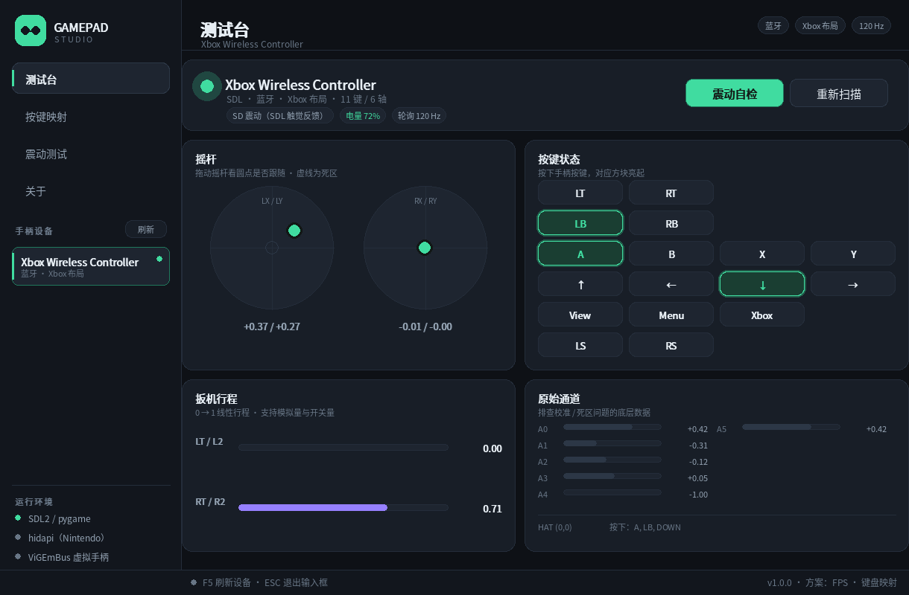

# Gamepad Studio

Windows 手柄测试与按键映射工具。插上手柄即可实时看到**按键、摇杆、扳机、十字键**的状态，
支持自定义映射方案（JSON）、震动测试（Switch Joy-Con HD 震动 / Xbox SD 触觉），
并附带一键安装程序，装完桌面直接启动。



## 功能

| 模块 | 说明 |
| --- | --- |
| 测试台 | 设备信息、摇杆轨迹与死区、17 个语义按键高亮、扳机行程、原始通道数据、按键事件日志 |
| 按键映射 | 捕获手柄来源 → 指定输出（键盘/鼠标、虚拟 Xbox 360、虚拟 DualShock 4），方案存为 JSON，可加载/分享 |
| 震动测试 | 4 种波形（持续/脉冲/渐强渐弱/心跳）、低频高频独立强度、单通道分测，带包络可视化 |
| 关于 | 运行环境自检（pygame/SDL、hidapi、vgamepad、ViGEmBus、键盘注入）、数据目录、快捷键 |

支持设备：Xbox 系列（XInput / 蓝牙）、DualShock 4 / DualSense、Switch Pro Controller、
Joy-Con（L/R，走 HID 直连读报文与 HD 震动）、各类通用 HID 手柄。

## 快速开始

### 方式一：安装包（推荐）

1. 运行 `GamepadStudio-Setup-1.0.0.exe`，按向导完成安装（默认包含 Python 运行时与全部依赖，离线可装）；
2. 桌面出现「Gamepad Studio」快捷方式，双击启动；
3. 手柄 USB 直连或蓝牙配对后，左侧设备列表会自动出现该手柄，点选即可开始测试。

安装程序会创建以下目录结构：

```
C:\Program Files\Gamepad Studio\
├─ runtime\     内嵌 Python 3.11 + pygame/hidapi/inputs/vgamepad
├─ app\         Gamepad Studio 程序、字体、示例映射方案、文档
└─ tools\       依赖自检脚本、ViGEmBus 驱动安装包
```

### 方式二：源码运行

```powershell
pip install pygame hidapi inputs vgamepad
$env:PYTHONPATH = "src"
python -m gamepadstudio.main
```

## 目录结构

```
GamepadStudio/
├─ src/gamepadstudio/          程序源码
│  ├─ main.py                  入口（日志 / DPI / 截图自检）
│  ├─ paths.py                 安装版与源码版的路径解析
│  ├─ settings.py              %APPDATA%\GamepadStudio\settings.json
│  ├─ core/                    设备与输入
│  │  ├─ model.py              DeviceInfo / PadState / 死区与归一化
│  │  ├─ layouts.py            SDL 通道 → 语义按键，品牌布局标签
│  │  ├─ backend_sdl.py        pygame/SDL2 后端（枚举、轮询、震动）
│  │  ├─ backend_hid.py        hidapi 后端（Nintendo 设备线程读报文）
│  │  ├─ hid/joycon.py         Joy-Con 协议：0x30 报文解析 + 震动编码
│  │  ├─ device_manager.py     双后端聚合、热插拔、震动路由
│  │  ├─ mapping.py            映射方案 JSON、来源捕获、输出换算
│  │  ├─ rumble.py             波形引擎（包络调度）
│  │  └─ virtual_pad.py        ViGEmBus + vgamepad 虚拟手柄
│  ├─ gui/                     pygame 自绘界面
│  │  ├─ app.py                主循环、侧边栏、状态栏、页面调度
│  │  ├─ widgets.py            即时模式控件库
│  │  ├─ theme.py              配色与字体
│  │  └─ screens/              测试台 / 映射 / 震动 / 关于
│  └─ platform/                Windows 原生能力
│     ├─ win_keyboard.py       SendInput 键盘鼠标注入
│     └─ win_dialog.py         comdlg32 原生文件对话框
├─ profiles/                   示例映射方案（JSON）
├─ assets/                     字体（思源黑体 SC）、图标
├─ installer/                  NSIS 安装脚本
├─ build/                      打包脚本与产物
├─ tests/                      单元测试（33 项）
└─ docs/                       使用说明、架构说明、界面截图
```

## 按键映射 JSON 格式

```json
{
  "schema": "gamepadstudio.mapping/1",
  "name": "FPS · 键盘映射",
  "target": "keyboard",
  "deadzone": 0.12,
  "invert_axes": ["ly", "ry"],
  "bindings": [
    {"source": "button:rb", "action": "keyboard:mouse_left"},
    {"source": "axis:rt:+", "action": "keyboard:SPACE"}
  ]
}
```

* `source`：`button:<语义键>` 或 `axis:<轴>:<+ / ->`（轴：`lx ly rx ry lt rt`）
* `action`：`keyboard:<按键或组合>`、`virtual:<手柄键>`、`none`
* `target`：`monitor`（仅监视）、`keyboard`、`virtual_xbox360`、`virtual_dualshock4`

界面上的「启用输出」默认关闭 —— 只有显式打开后才会真的向系统发送按键或驱动虚拟手柄。

## 打包

```bash
python build/build_installer.py          # 组装 runtime + 调 NSIS 出安装包
python build/make_icon.py                # 重新生成图标
python -m unittest discover -s tests -t .   # 单元测试
```

详见 [docs/架构与打包.md](docs/架构与打包.md)。

## 开源组件与协议参考

* [pygame](https://github.com/pygame/pygame) / SDL2 —— 设备枚举、输入轮询、触觉反馈
* [hidapi](https://github.com/apmorton/pyhidapi) —— Joy-Con 直连读写
* [vgamepad](https://github.com/yannbouteiller/vgamepad)、[ViGEmBus](https://github.com/nefarius/ViGEmBus) —— 虚拟手柄输出与驱动
* [Nintendo_Switch_Reverse_Engineering](https://github.com/dekuNukem/Nintendo_Switch_Reverse_Engineering) —— 报文布局与震动编码公式
* [joycon-python](https://github.com/ytai/joycon-python) —— 输出报文握手流程参考
* [gamepad-tester](https://github.com/robertodr/gamepad-tester) —— 界面信息组织参考
* [inputs](https://github.com/zeth/inputs) —— 键盘/手柄事件抽象参考

字体：Noto Sans CJK SC（SIL Open Font License）。

## 许可

MIT
