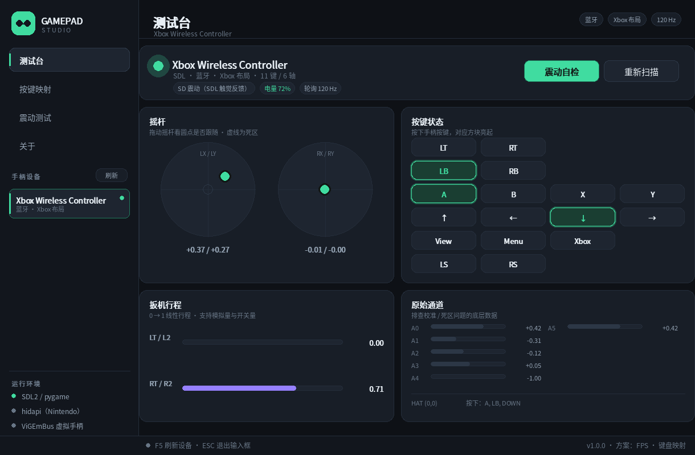
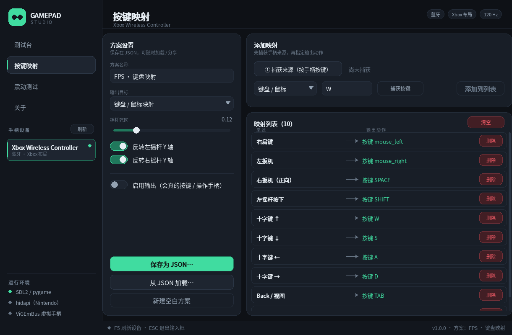
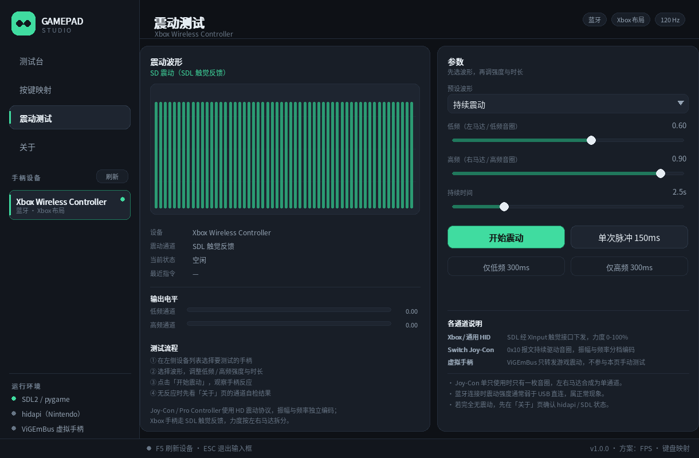

# Gamepad Studio 使用说明

版本 1.0.0 · Windows 10/11 64 位

---

## 1. 安装

1. 双击 `GamepadStudio-Setup-1.0.0.exe`；
2. 选择组件：
   - **主程序（必需）**：程序本体 + 内嵌 Python 运行时 + 依赖库（离线即可用）；
   - **桌面快捷方式**：装完桌面会生成「Gamepad Studio」图标；
   - **开始菜单**：含「依赖自检（修复）」与本文档入口；
   - **ViGEmBus 虚拟手柄驱动**：需要「把手柄映射成虚拟 Xbox 360 / DualShock 4」时勾选，已装过会自动跳过。
3. 安装结束时安装程序会做一次依赖自检，日志在 `runtime\bootstrap.log`。

> 安装到 `C:\Program Files\Gamepad Studio` 需要管理员权限；安装过程不会修改系统其他设置，
> ViGEmBus 是独立驱动，卸载本程序时会保留（其他软件可能也在使用）。

## 2. 连接手柄

| 连接方式 | 说明 |
| --- | --- |
| USB 直连 | 插上后在 1 秒内出现，Xbox / DualShock / Pro Controller 都建议优先用有线 |
| 蓝牙 | Windows 设置 → 蓝牙和其他设备 → 添加设备，配对后按 F5 或点侧栏「刷新」 |
| Joy-Con | 左右手可单独配对；因为 SDL 对单只 Joy-Con 支持有限，程序改用 hidapi 直连读取，可获得完整按键与 HD 震动 |

左侧「手柄设备」列表会显示每个设备的连接方式与布局；点选其中一个即可在右侧测试。

## 3. 测试台

* **设备卡片**：名称、后端（SDL / HID）、连接方式、按键轴数量、震动通道、电量（Nintendo 设备可读）、实时轮询率；
  右侧「震动自检」会发送一次 140ms 脉冲，「重新扫描」重枚举设备。
* **摇杆**：圆点跟随摇杆位置，虚线圆是死区；浅色轨迹是最近 2 秒的移动路径，用来判断回中是否抖动。
* **按键状态**：17 个语义按键（A/B/X/Y、LB/RB、LT/RT、十字键、Back/Start/Guide、L3/R3），按下即高亮。
* **扳机行程**：0 → 1 的模拟量，顶部细线是该通道最近 1.5 秒的走势。
* **原始通道**：`A0…A5` 原始轴值、HAT 十字键状态、当前按下集合、最近事件日志。
  排查「摇杆漂移」「扳机只到 0.8」这类问题时以这里为准。

## 4. 按键映射

1. 左侧「方案设置」：改方案名、选输出目标、调摇杆死区、反转 Y 轴；
2. 点「① 捕获来源（按手柄按键）」，然后按手柄上想映射的键（或把摇杆/扳机推过阈值），来源会自动填入；
3. 选输出动作：
   - **键盘 / 鼠标**：可直接输入 `W`、`CTRL+SHIFT+S` 这类组合，或点「捕获按键」后按键盘对应键；
   - **虚拟手柄按键**：从下拉里选 A/B/X/Y/LB/RB/LT/RT/方向键等；
   - **不输出**：只记录，方便先搭结构；
4. 点「添加到列表」；同一来源重复添加会覆盖旧动作；
5. 「保存为 JSON…」写入文件，「从 JSON 加载…」读取他人分享的方案。

**输出开关**：左下「启用输出」默认关闭。关闭时一切只在界面里演算，不会真的按键或操作手柄；
打开后才会按方案向系统注入键盘事件或驱动虚拟手柄（虚拟手柄需 ViGEmBus）。

示例方案在 `app\profiles\`：FPS 键盘映射、赛车扳机线性油门、Switch 仅监视。

## 5. 震动测试

* **波形**：持续震动 / 断续脉冲（0.45s 通断）/ 渐强渐弱（1.4s 循环）/ 心跳（双短脉冲）；
* **参数**：低频、高频强度各自独立 0–1，持续时长 0.3–10s；
* **单次脉冲 150ms**、**仅低频 300ms**、**仅高频 300ms** 用于分别验证左右马达/音圈；
* 左侧波形图会显示包络与当前播放位置，「输出电平」实时显示两路目标振幅。

不同设备的震动通道：

| 设备 | 通道 | 说明 |
| --- | --- | --- |
| Xbox / 通用 HID | SDL 触觉反馈 | SDL 经 XInput 下发，力度按左右马达拆分 |
| Switch Pro Controller / Joy-Con | HID 音圈驱动 | 0x10 报文持续驱动，振幅与频率分档编码（HD 震动） |
| 虚拟手柄 | — | 只转发游戏下发的震动，不参与本页手动测试 |

## 6. 常见问题

**看不到手柄**
1. 换个 USB 口（优先机箱后面板直连，避免无源 HUB）；
2. 蓝牙设备先在「设置 → 蓝牙和其他设备」里确认已连接，再按 F5；
3. 部分手柄（如 Switch Pro）在 Steam 里被独占时会被隐藏，先退出 Steam；
4. 打开「关于」页看 SDL / hidapi 是否都显示正常。

**按键对不上**
不同品牌布局不同：Xbox 是 A/B/X/Y，PlayStation 是 ✕/○/□/△，Switch 是 A/B/X/Y 但物理位置相反。
程序按「物理位置」标注，可以在左侧设备列表确认布局类型；需要严格对应时用「捕获来源」直接按实体键。

**摇杆无法回中 / 轻微漂移**
属于硬件公差。把死区调到 0.15–0.25 即可屏蔽；若某个方向始终偏移很大，在「原始通道」里确认是否单侧值异常。

**震动没反应**
1. 先用「单次脉冲 150ms」确认通道；
2. 蓝牙连接强度明显弱于 USB，属正常；
3. Joy-Con 单只使用时只有一枚音圈，左右会合成为单通道；
4. 第三方手柄可能只声明了 SDL 震动却未实现，换 USB 或换设备验证。

**虚拟手柄创建失败**
提示 `ViGEmBus 驱动未安装` 时：开始菜单 → Gamepad Studio → 「依赖自检（修复）」，
或手动运行 `tools\ViGEmBus_Setup.exe`，装完建议重启一次。

---

数据目录：`%APPDATA%\GamepadStudio`（`profiles\` 映射方案、`logs\app.log` 运行日志）。
删除该目录即可恢复出厂状态。
